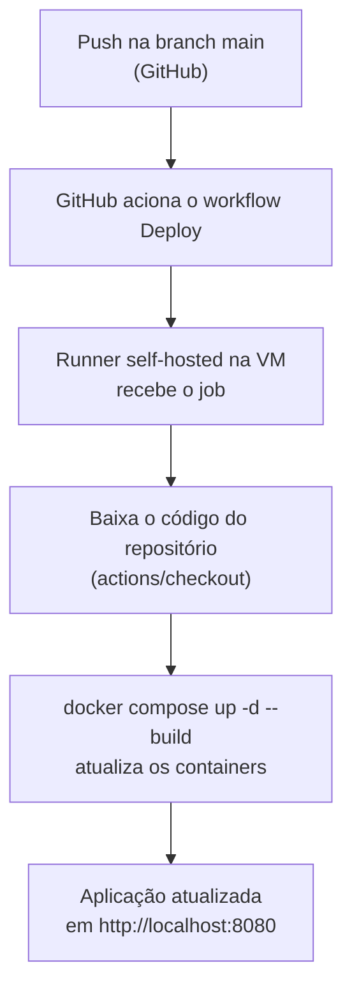

# Cardápio Padaria — Deploy automático em VM com GitHub Actions

Trabalho 2 de DevOps Avançado — UniALFA

## Integrantes

- Mihari Barbosa da Silva
- Arthur Antunes de Oliveira

## Descrição do CRUD e tecnologias

Aplicação web CRUD (Create, Read, Update, Delete) para gerenciar os itens do cardápio de uma padaria: cadastrar, listar, editar e excluir produtos como pães, bolos e outros itens.

**Entidade:** Itens do Cardápio (tabela `itens_cardapio`)

| Campo | Descrição |
|---|---|
| `id` | Identificador único (chave primária, auto incremento) |
| `nome` | Nome do item (ex.: "Pão Francês") |
| `descricao` | Descrição do item |
| `preco` | Preço do item |
| `data_cadastro` | Data e hora do cadastro |

**Tecnologias:**

- **PHP 8.3 com Apache** (imagem `php:8.3-apache`): linguagem e servidor da aplicação.
- **MySQL 8.4**: banco de dados, com os dados persistidos em volume (`mysql_data`).
- **phpMyAdmin**: interface visual para conferir o banco.
- **Docker e Docker Compose**: executam os três serviços (`php`, `mysql`, `phpmyadmin`) na rede `padaria-rede`.
- **GitHub Actions com runner self-hosted**: fazem o deploy automático.
- **VirtualBox com Ubuntu Server 22.04**: máquina virtual que hospeda a aplicação e o runner.

A tabela é criada automaticamente pelo `app/config.php` (`CREATE TABLE IF NOT EXISTS`), sem script SQL manual. O `config.php` também tenta reconectar ao banco até 10 vezes, para o caso de o MySQL demorar a ficar pronto.

## Como funciona o deploy automático



### O que é o runner local (self-hosted)

Normalmente os workflows do GitHub Actions rodam em servidores do próprio GitHub. Um **runner self-hosted** é um programa instalado em uma máquina nossa, no caso a VM Ubuntu, que fica conectado ao repositório aguardando trabalho. Quando acontece um push, o GitHub envia o job para esse runner, e os comandos são executados **dentro da VM**, onde a aplicação está rodando. Assim o deploy acontece direto na máquina que hospeda a aplicação, sem copiar arquivos manualmente. O runner foi instalado como serviço (`svc.sh`), então continua ligado mesmo com o terminal fechado, e aparece como **Idle** em *Settings → Actions → Runners*.

### Explicação do `deploy.yml`

```yaml
name: Deploy

on:
  push:
    branches: [main]

jobs:
  deploy:
    runs-on: self-hosted
    steps:
      - uses: actions/checkout@v4

      - name: Subir aplicacao
        run: docker compose up -d --build

      - name: Mostrar containers
        run: docker compose ps
```

| Nº | Trecho | O que faz |
|---|---|---|
| 1 | `name: Deploy` | Nome do workflow exibido na aba Actions. |
| 2 | `on: push` | Executa o workflow quando alterações são enviadas ao repositório. |
| 3 | `branches: [main]` | Restringe a execução aos pushes na branch `main`. |
| 4 | `jobs: deploy` | Define o job responsável pela atualização da aplicação. |
| 5 | `runs-on: self-hosted` | Executa o job no runner instalado na VM, e não nos servidores do GitHub. |
| 6 | `actions/checkout@v4` | Baixa o código do repositório para a pasta de trabalho do runner. |
| 7 | `name: Subir aplicacao` | Nome da etapa exibido no log. |
| 8 | `docker compose up -d --build` | Sobe os containers em segundo plano (`-d`) e reconstrói o que mudou (`--build`). Como a pasta `app/` é espelhada para dentro do container por volume, o código novo passa a ser servido imediatamente. |
| 9 | `docker compose ps` | Lista os containers e seu estado, como conferência no log. |

## Instalações necessárias na VM

**No computador (host):**

1. **VirtualBox**.
2. Uma VM **Ubuntu Server 22.04** com 2 GB de RAM e 2 CPUs.
3. Em *Configurações → Rede → Adaptador 1 (NAT) → Redirecionamento de Portas*, estas regras:

| Nome | Porta do hospedeiro | Porta do convidado |
|---|---|---|
| ssh | 2222 | 22 |
| app | 8080 | 8080 |
| phpmyadmin | 8081 | 8081 |

**Dentro da VM** (acesso por `ssh vagrant@127.0.0.1 -p 2222`):

```bash
# Docker e Git
sudo apt update
sudo apt install -y docker.io git
sudo usermod -aG docker $USER
# sair e entrar de novo para o grupo docker valer

# Docker Compose
sudo mkdir -p /usr/local/lib/docker/cli-plugins
sudo curl -SL https://github.com/docker/compose/releases/latest/download/docker-compose-linux-x86_64 -o /usr/local/lib/docker/cli-plugins/docker-compose
sudo chmod +x /usr/local/lib/docker/cli-plugins/docker-compose
docker compose version
```

**Runner self-hosted:**

1. No repositório: *Settings → Actions → Runners → New self-hosted runner* (Linux, x64).
2. Executar na VM os comandos de **Download** e **Configure** que o GitHub mostra.
3. Instalar como serviço, para ficar sempre ligado:

```bash
sudo ./svc.sh install
sudo ./svc.sh start
sudo ./svc.sh status
```

## Como acessar a aplicação

| Serviço | Endereço |
|---|---|
| Aplicação (CRUD) | `http://localhost:8080` |
| phpMyAdmin | `http://localhost:8081` (usuário `app`, senha `app`) |

O acesso é feito pelo computador que hospeda a VM, graças ao redirecionamento de portas do VirtualBox. Na primeira subida, aguarde de 30 a 60 segundos: o container `php` instala as extensões `mysqli`, `pdo` e `pdo_mysql` antes de o Apache iniciar.

## Demonstração do deploy automático

1. Alterar um conteúdo da aplicação (por exemplo, um texto em `app/`).
2. Fazer commit na branch `main`.
3. Em **Actions**, o workflow **Deploy** é executado sozinho no runner da VM.
4. Ao atualizar `http://localhost:8080`, a nova versão aparece, sem deploy manual.
